<div align="center">

# 🦁 XXD Shop 009 | 고전환 메인 비주얼

### 정보가 아무리 많아도, 첫눈에 어디를 봐야 할지 늘 알 수 있게

<a href="README.md">简体中文</a> · <a href="README.en.md">English</a> · <a href="README.ja.md">日本語</a> · <strong>한국어</strong> · <a href="README.ar.md">العربية</a>

</div>

**정보를 많이 담아도 어디를 먼저 봐야 할지 늘 분명한 세일 이미지를.**
한 장에 가장 강한 중심은 하나. 가격·장점·사양은 각자의 묶음으로, 숫자는 내가 준 것만.

| 한눈에 보기 | |
|---|---|
| **맡기는 것** | 상품 이미지 또는 상품명, 셀링 포인트(한 단락도 가능), 가격·정가·기간·사양 등의 사실 |
| **받는 것** | 1:1 대표 이미지, 3:4 상세페이지 첫 화면 등. 장마다 역할이 다른 대표 이미지 5연작 세트도 |
| **스타일 특징** | 무게감 있는 실제 상품 · 가장 강한 중심 하나 · 묶이고 층이 있는 글자 · 정말 효과 있는 소수의 포인트 |
| **가장 잘 맞는 곳** | 세일 시즌 대표 이미지, 특가 이미지, 선물세트 첫 화면, 대표 이미지 세트 |

> **설치한 뒤에는 이렇게 말하면 됩니다:**
>
> /xxd-shop-009 광군제 에어프라이어: 지금 ¥299, 정가 ¥459, 11월 1~11일. 장점은 6L 용량, 확인 창, 뒤집을 필요 없음

<!-- xxd-samples:start -->
## 예시

<p align="center"><a href="assets/examples/s01-size-1x1-1254x1254.png">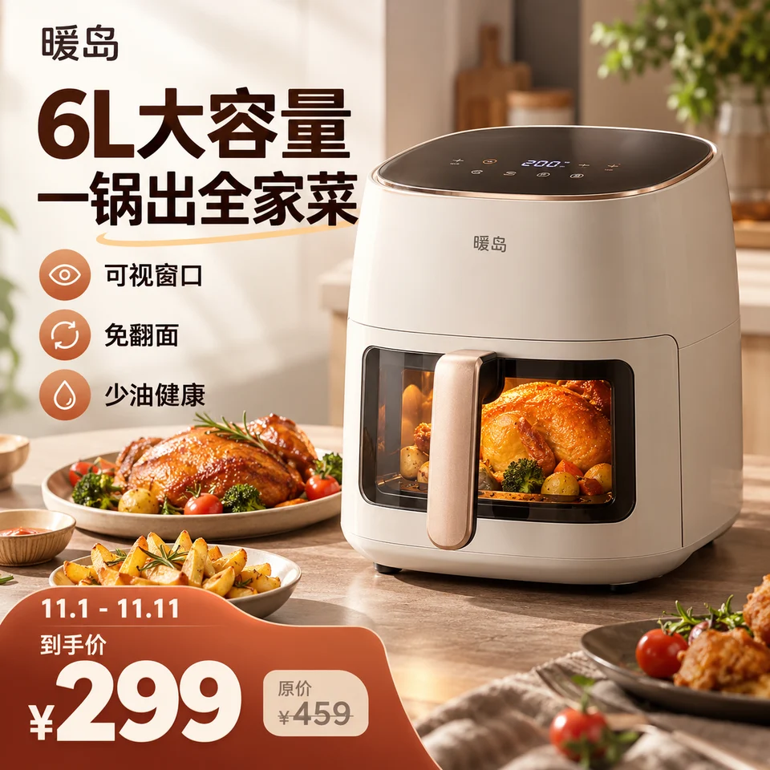</a><br><sub>세일 대표 이미지 · 1:1 · 1254x1254<br>NUANDAO 6L 에어프라이어 · <a href="assets/examples/sources/product-nuandao-fryer.jpg">상품 이미지</a> + <a href="assets/examples/sources/logo-nuandao.png">Logo</a> · 문구 기획안 (중국어)</sub></p>

### 만들 수 있는 카테고리

한 칸에 카테고리 하나. 클릭하면 크게 볼 수 있습니다. 용도·비율·픽셀·입력은 아래 각 섹션에 있습니다.

<table>
<tr><td align="center" valign="top"><a href="assets/examples/c01-category-1x1-1254x1254.png">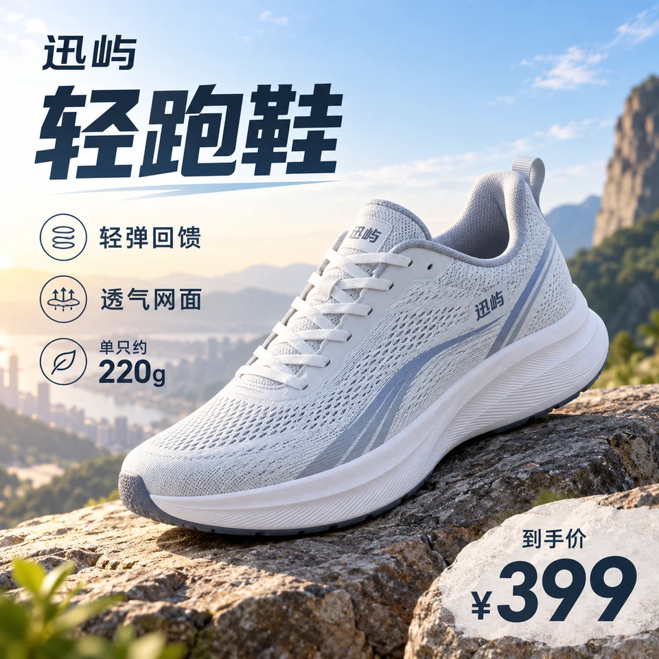</a><br><sub><b>신발</b><br>세일 대표 이미지</sub></td><td align="center" valign="top"><a href="assets/examples/c02-category-1x1-1254x1254.png">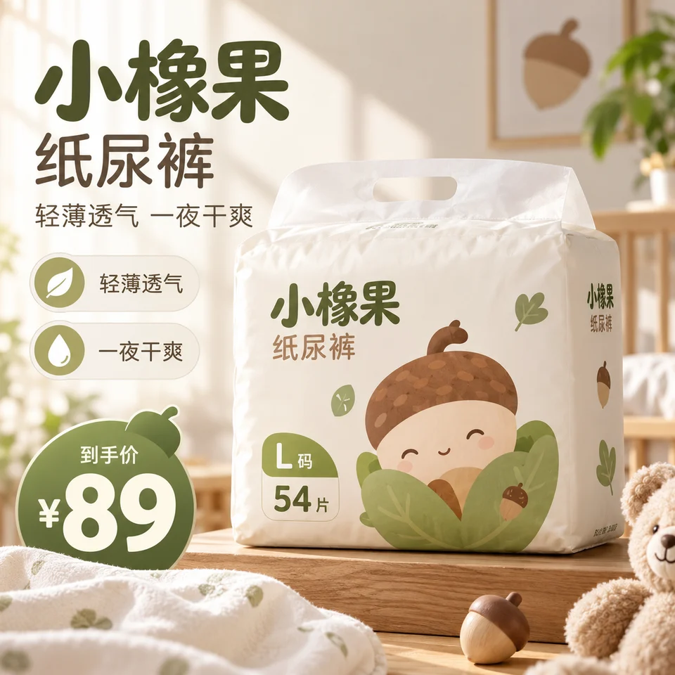</a><br><sub><b>유아·출산</b><br>세일 대표 이미지</sub></td><td align="center" valign="top"><a href="assets/examples/c03-category-3x4-1086x1448.png">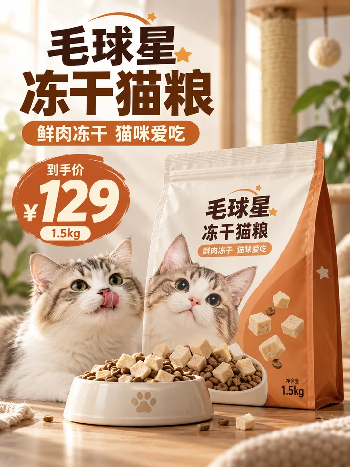</a><br><sub><b>반려동물</b><br>3:4 대표 이미지</sub></td><td align="center" valign="top"><a href="assets/examples/c04-category-1x1-1254x1254.png">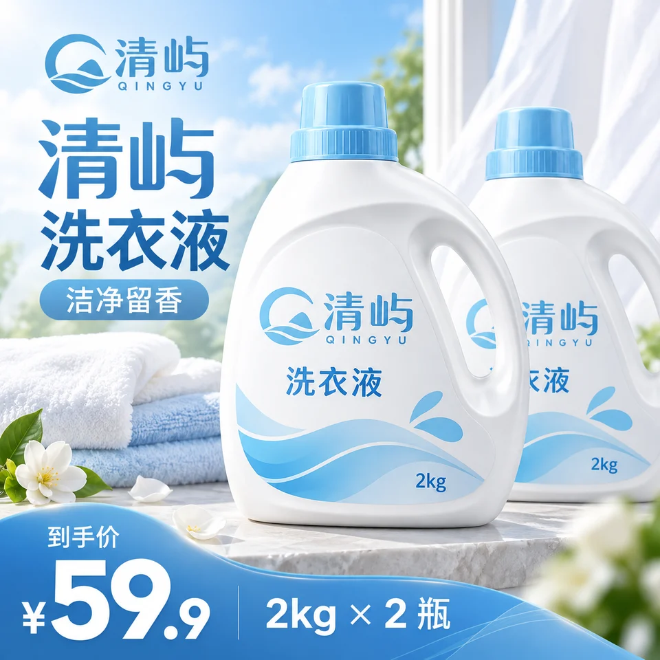</a><br><sub><b>퍼스널케어·세정</b><br>세일 대표 이미지</sub></td><td align="center" valign="top"><a href="assets/examples/c05-category-16x9-1672x941.png">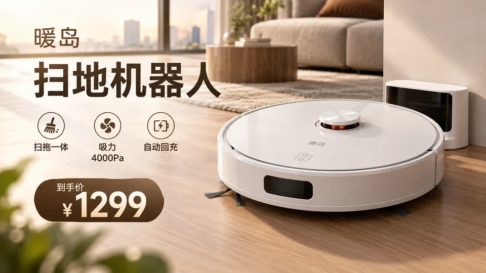</a><br><sub><b>가전</b><br>행사 배너</sub></td><td align="center" valign="top"><a href="assets/examples/c06-category-1x1-1254x1254.png">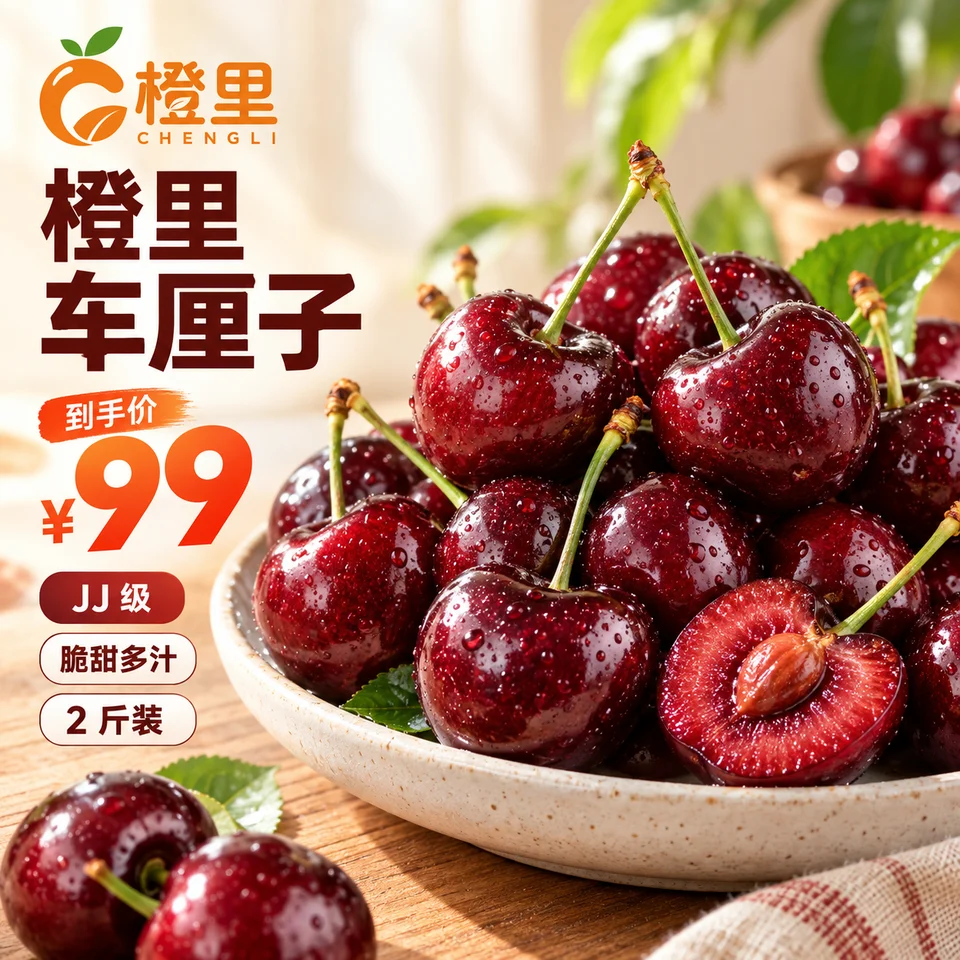</a><br><sub><b>신선식품</b><br>세일 대표 이미지</sub></td></tr>
<tr><td align="center" valign="top"><a href="assets/examples/s10-special-1x1-1254x1254.png">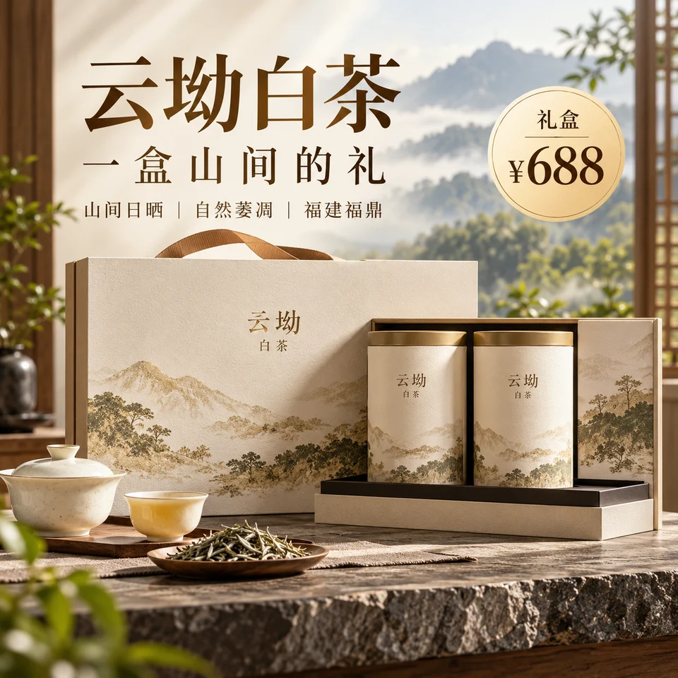</a><br><sub><b>티 음료</b><br>선물용 대표 이미지</sub></td></tr>
</table>

### 상품 하나로 모든 게재 위치를

같은 상품, 같은 스타일이라도 비율마다 구도를 새로 잡습니다. 잘라낸 것이 아닙니다.

<table>
<tr><td align="center" valign="top"><a href="assets/examples/s01-size-1x1-1254x1254.png"></a><br><sub>세일 대표 이미지 · 1:1 · 1254x1254<br>NUANDAO 6L 에어프라이어 · <a href="assets/examples/sources/product-nuandao-fryer.jpg">상품 이미지</a> + <a href="assets/examples/sources/logo-nuandao.png">Logo</a> · 문구 기획안 (중국어)</sub></td><td align="center" valign="top"><a href="assets/examples/s02-size-3x4-1086x1448.png">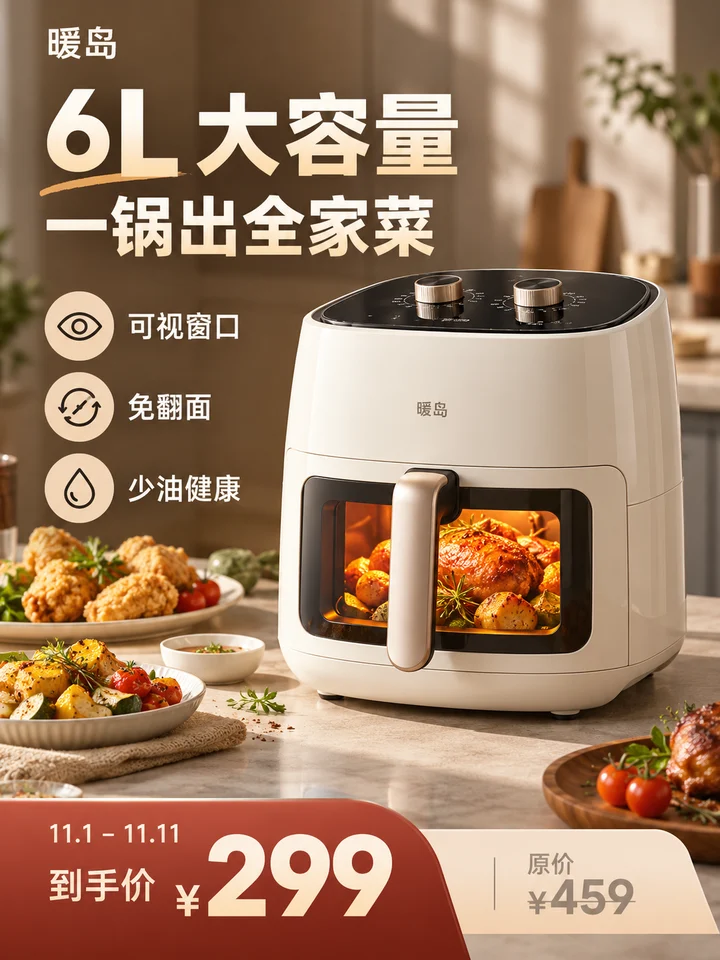</a><br><sub>3:4 대표 이미지 · 3:4 · 1086x1448<br>NUANDAO 6L 에어프라이어 · <a href="assets/examples/sources/product-nuandao-fryer.jpg">상품 이미지</a> + <a href="assets/examples/sources/logo-nuandao.png">Logo</a> · 문구 기획안 (중국어)</sub></td><td align="center" valign="top"><a href="assets/examples/s03-size-9x16-941x1672.png">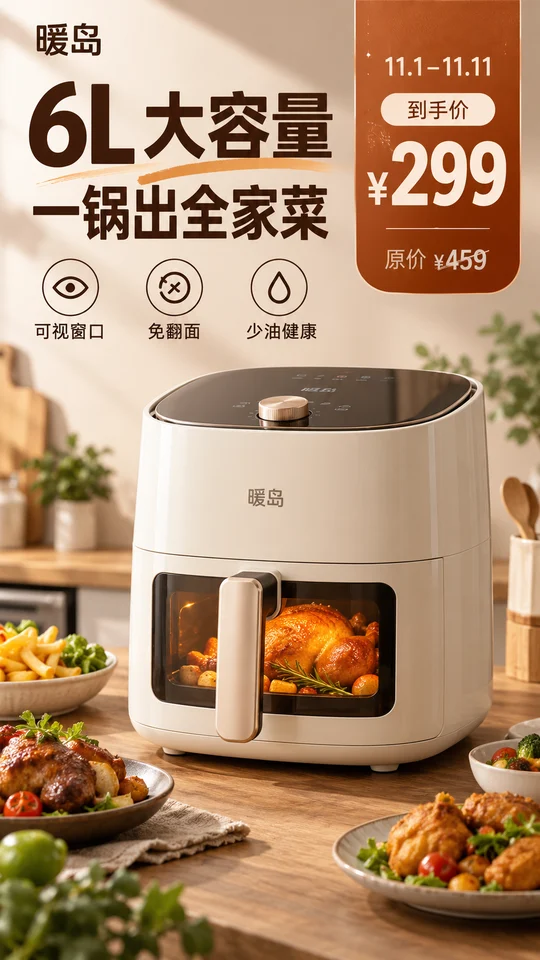</a><br><sub>스플래시 화면 · 9:16 · 941x1672<br>NUANDAO 6L 에어프라이어 · <a href="assets/examples/sources/product-nuandao-fryer.jpg">상품 이미지</a> + <a href="assets/examples/sources/logo-nuandao.png">Logo</a> · 문구 기획안 (중국어)</sub></td><td align="center" valign="top"><a href="assets/examples/s04-size-16x9-1672x941.png">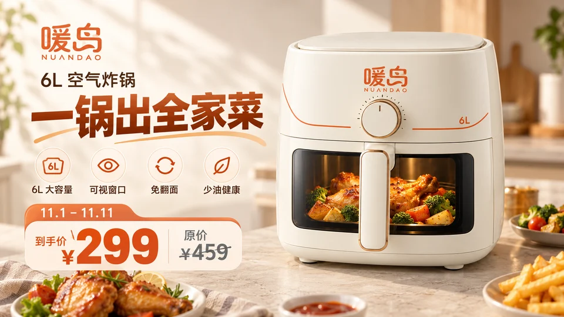</a><br><sub>행사 배너 · 16:9 · 1672x941<br>NUANDAO 6L 에어프라이어 · <a href="assets/examples/sources/product-nuandao-fryer.jpg">상품 이미지</a> + <a href="assets/examples/sources/logo-nuandao.png">Logo</a> · 문구 기획안 (중국어)</sub></td></tr>
</table>

### 대표 이미지 5연작 (세트): 이 상품은 자료가 있는 항목이 4개뿐이라 4장

<table>
<tr><td align="center" valign="top"><a href="assets/examples/p01-set-1x1-1254x1254.png">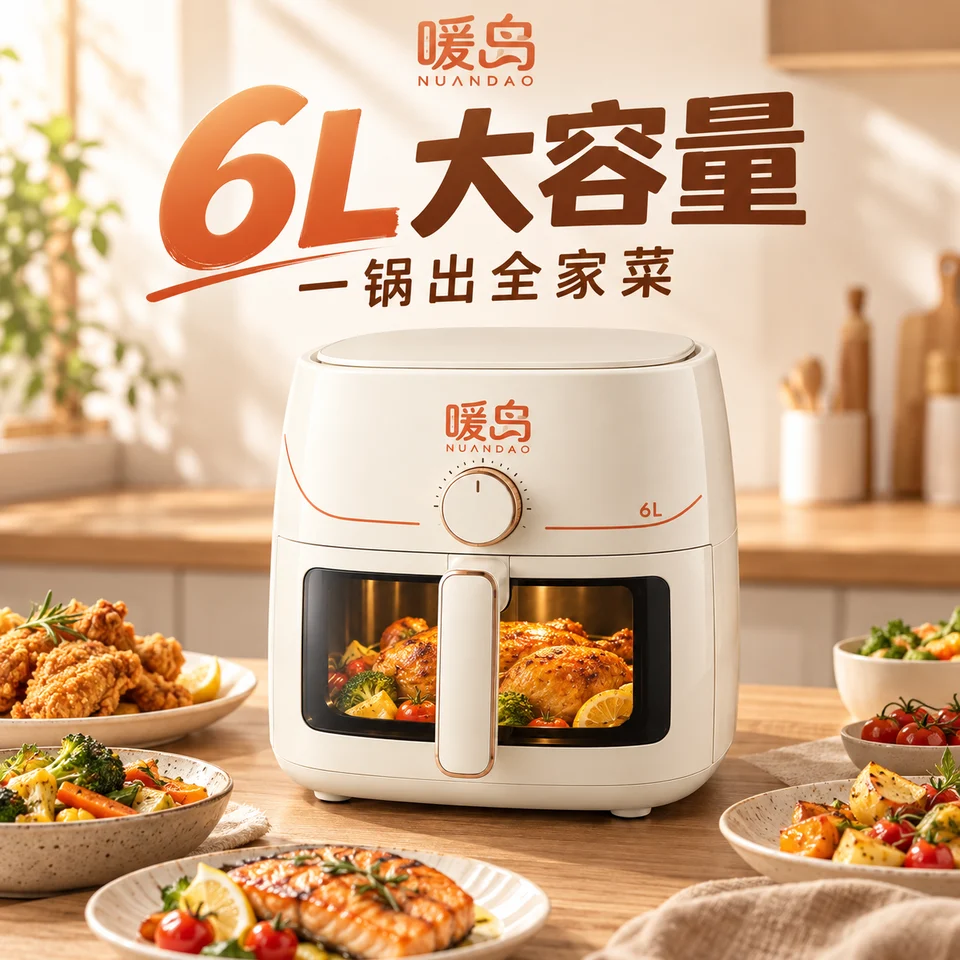</a><br><sub>대표 이미지 5연작 · 1:1 · 1254x1254<br>NUANDAO 6L 에어프라이어 · <a href="assets/examples/sources/product-nuandao-fryer.jpg">상품 이미지</a> + <a href="assets/examples/sources/logo-nuandao.png">Logo</a> · 문구 기획안 (중국어)<br>4장 중 1번째</sub></td><td align="center" valign="top"><a href="assets/examples/p02-set-1x1-1254x1254.png">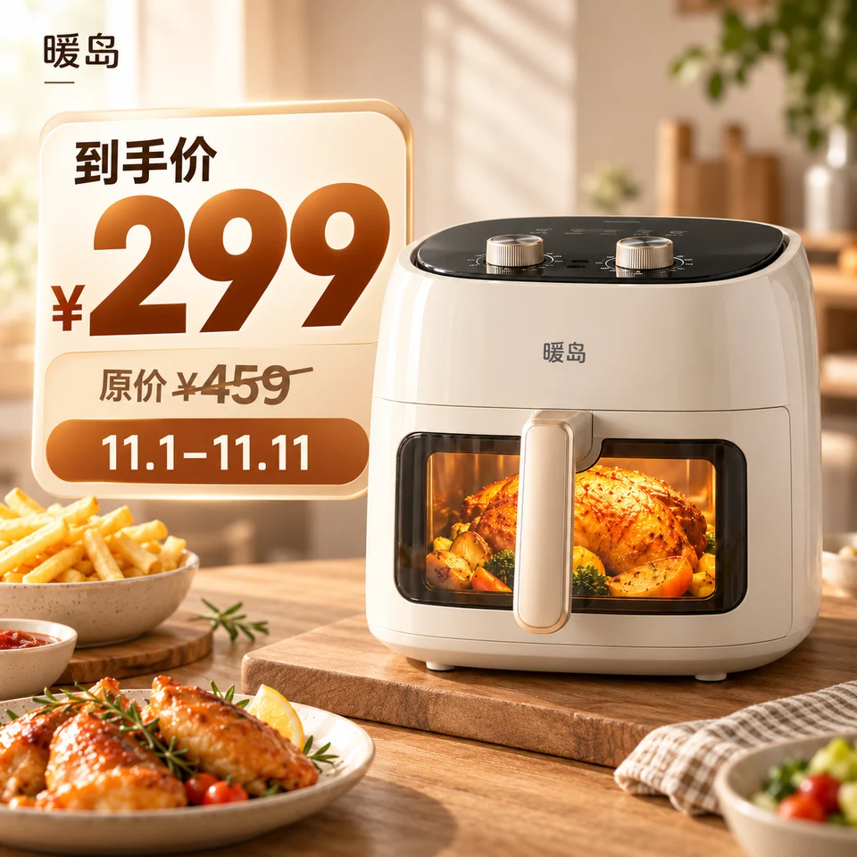</a><br><sub>대표 이미지 5연작 · 1:1 · 1254x1254<br>NUANDAO 6L 에어프라이어 · <a href="assets/examples/sources/product-nuandao-fryer.jpg">상품 이미지</a> + <a href="assets/examples/sources/logo-nuandao.png">Logo</a> · 지정 문구 그대로 (중국어)<br>4장 중 2번째</sub></td><td align="center" valign="top"><a href="assets/examples/p03-set-1x1-1254x1254.png">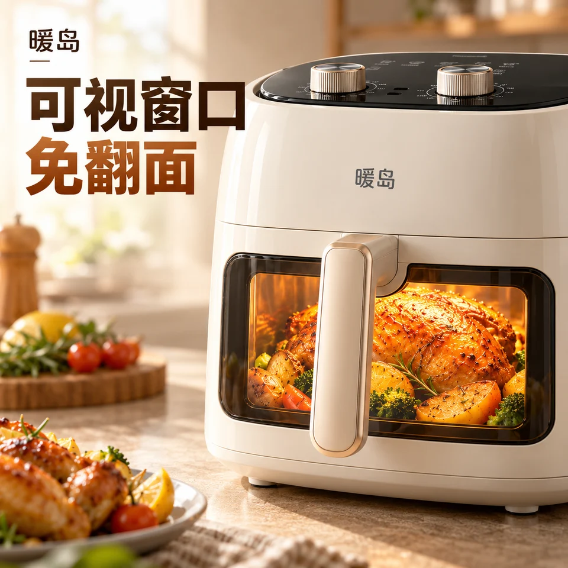</a><br><sub>대표 이미지 5연작 · 1:1 · 1254x1254<br>NUANDAO 6L 에어프라이어 · <a href="assets/examples/sources/product-nuandao-fryer.jpg">상품 이미지</a> + <a href="assets/examples/sources/logo-nuandao.png">Logo</a> · 문구 기획안 (중국어)<br>4장 중 3번째</sub></td><td align="center" valign="top"><a href="assets/examples/p04-set-1x1-1254x1254.png">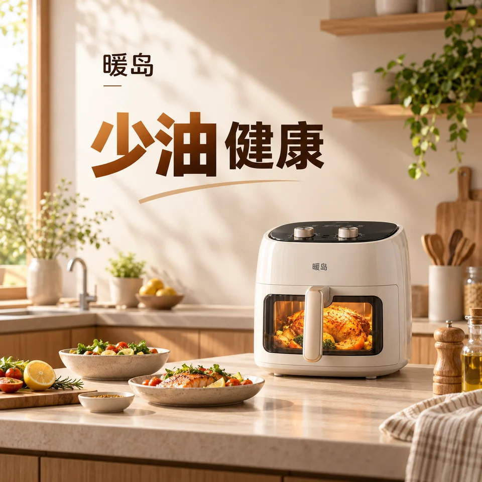</a><br><sub>대표 이미지 5연작 · 1:1 · 1254x1254<br>NUANDAO 6L 에어프라이어 · <a href="assets/examples/sources/product-nuandao-fryer.jpg">상품 이미지</a> + <a href="assets/examples/sources/logo-nuandao.png">Logo</a> · 문구 기획안 (중국어)<br>4장 중 4번째</sub></td></tr>
</table>

### 카테고리가 바뀌어도 통한다

<table>
<tr><td align="center" valign="top"><a href="assets/examples/c01-category-1x1-1254x1254.png"></a><br><sub>세일 대표 이미지 · 1:1 · 1254x1254<br>XUNYU 경량 러닝화 · <a href="assets/examples/sources/product-xunyu-shoe.jpg">상품 이미지</a> + <a href="assets/examples/sources/logo-xunyu.png">Logo</a> · 문구 기획안 (중국어)</sub></td><td align="center" valign="top"><a href="assets/examples/c02-category-1x1-1254x1254.png"></a><br><sub>세일 대표 이미지 · 1:1 · 1254x1254<br>XIAOXIANGGUO 기저귀 · <a href="assets/examples/sources/product-xxg-diaper.jpg">상품 이미지</a> + <a href="assets/examples/sources/logo-xiaoxiangguo.png">Logo</a> · 문구 기획안 (중국어)</sub></td><td align="center" valign="top"><a href="assets/examples/c03-category-3x4-1086x1448.png"></a><br><sub>3:4 대표 이미지 · 3:4 · 1086x1448<br>MAOQIUXING 동결건조 고양이 사료 · <a href="assets/examples/sources/product-mqx-catfood.jpg">상품 이미지</a> + <a href="assets/examples/sources/logo-maoqiuxing.png">Logo</a> · 문구 기획안 (중국어)</sub></td></tr>
<tr><td align="center" valign="top"><a href="assets/examples/c04-category-1x1-1254x1254.png"></a><br><sub>세일 대표 이미지 · 1:1 · 1254x1254<br>QINGYU 세탁세제 · <a href="assets/examples/sources/product-qy-laundry.jpg">상품 이미지</a> + <a href="assets/examples/sources/logo-qingyu.png">Logo</a> · 문구 기획안 (중국어)</sub></td><td align="center" valign="top"><a href="assets/examples/c05-category-16x9-1672x941.png"></a><br><sub>행사 배너 · 16:9 · 1672x941<br>NUANDAO 로봇청소기 · <a href="assets/examples/sources/product-nuandao-robot.jpg">상품 이미지</a> + <a href="assets/examples/sources/logo-nuandao.png">Logo</a> · 문구 기획안 (중국어)</sub></td><td align="center" valign="top"><a href="assets/examples/c06-category-1x1-1254x1254.png"></a><br><sub>세일 대표 이미지 · 1:1 · 1254x1254<br>CHENGLI 체리 · <a href="assets/examples/sources/logo-chengli.png">Logo</a> · 문구 기획안 (중국어)</sub></td></tr>
</table>

### 가격의 무게는 상품에 따라

<table>
<tr><td align="center" valign="top"><a href="assets/examples/s09-special-1x1-1254x1254.png">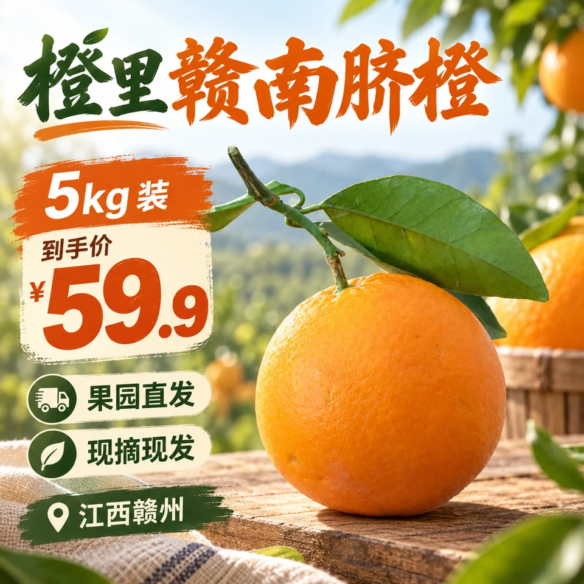</a><br><sub>세일 대표 이미지 · 1:1 · 1254x1254<br>CHENGLI 간난 배꼽오렌지 · <a href="assets/examples/sources/orange.jpg">원본 사진</a> + <a href="assets/examples/sources/logo-chengli.png">Logo</a> · 문구 기획안 (중국어)<br>이 장의 포인트: 가격 경쟁력 강조</sub></td><td align="center" valign="top"><a href="assets/examples/s10-special-1x1-1254x1254.png"></a><br><sub>선물용 대표 이미지 · 1:1 · 1254x1254<br>YUN'AO 백차 선물세트 · <a href="assets/examples/sources/product-yunao-giftbox.jpg">상품 이미지</a> + <a href="assets/examples/sources/logo-yunao.png">Logo</a> · 문구 기획안 (중국어)<br>이 장의 포인트: 선물 가치</sub></td><td align="center" valign="top"><a href="assets/examples/s11-special-1x1-1254x1254.png">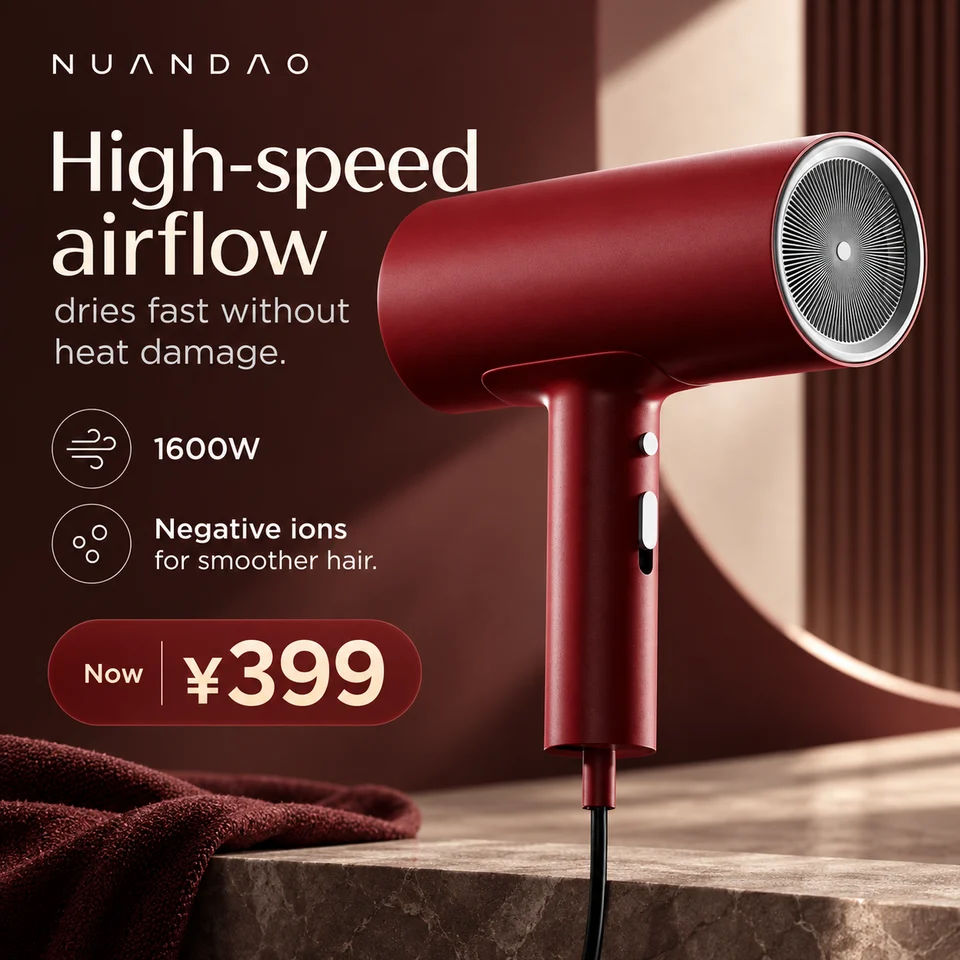</a><br><sub>해외직구 대표 이미지 · 1:1 · 1254x1254<br>NUANDAO 고속 헤어드라이어 (와인레드) · <a href="assets/examples/sources/product-nuandao-dryer-red.jpg">상품 이미지</a> + <a href="assets/examples/sources/logo-nuandao.png">Logo</a> · 문구 기획안 (영어)</sub></td></tr>
</table>

<sub>예시 상품은 모두 가상의 데모 브랜드이며, 가격·규격 등의 숫자도 데모용 설정입니다. 데모 상품 이미지와 로고는 이 프로젝트에서 만들었고, 일부는 Unsplash 사진을 바탕으로 했습니다. 출처와 라이선스는 [assets/examples/README.md](assets/examples/README.md)에 있습니다. 모든 이미지는 한 번의 생성으로 얻은 완성 화면 그대로이며, 리터칭·합성·업스케일 없이 실제 픽셀 크기를 표기했습니다. 육안 검수를 통과하지 못한 이미지는 다시 만들었고 여기에는 싣지 않았습니다. 클릭하면 원본 크기로 볼 수 있습니다.</sub>

<!-- xxd-samples:end -->

## 해결하는 문제

세일 이미지는 다섯 가지 장점을 한꺼번에 강조하고, 강한 색 세 가지를 섞고, 가격을 셀링 포인트 속에 끼워 넣다가 손님이 어디서부터 봐야 할지 모르게 되기 쉽습니다.

**Shop 009**는 빼고 정리합니다.

1. **이 한 장의 역할을 하나로 정한다:** 브랜드, 핵심 장점, 가격, 식욕, 신선함, 품질, 선물. 한 장에 가장 강한 중심은 하나.
2. **무게감 있는 실제 상품,** 깔끔한 주변, 윤곽을 가로지르는 장식 없음.
3. **먼저 상품의 색을 지키고,** 그다음 장면을 정한다. 정말 효과 있는 포인트만 몇 개 남긴다.
4. **글자를 묶는다:** 타이틀, 핵심 장점, 부가 장점, 가격과 구매, 원산지와 사양. 색을 늘리지 않고 크기·여백·위치로 나눈다.
5. **가격의 크기는 상품에 맞춘다:** 잦은 프로모션이면 앵커로, 고급 선물이면 조용하게.

> 팁: 가격이 장점보다 앞서게 하려면, 주는 판매 문구에서 가격을 맨 앞에 쓰세요. 첫 줄이 헤드라인이 될 가능성이 가장 높습니다.

## 001일까, 009일까

| | [001 프리미엄 상업 메인 비주얼](https://github.com/nevertoday/xxd-shop-001) | 009 고전환 메인 비주얼 |
|---|---|---|
| 분위기 | 조용하고 공기감 있는 브랜드 중심 | 전환 중심, 정보에 층이 있음 |
| 글자 | 타이틀은 있어도 없어도 | 글자와 이미지의 결합이 핵심 |
| 가격 | 보통 없음 | 비주얼 앵커가 될 수 있음 |

## 대표 이미지 5연작 세트

한 장에 가장 강한 중심은 하나이니, 다섯 장이면 다섯 가지를 말할 수 있습니다. 세트를 요청하면 스토리보드를 써서 장마다 하나의 역할(핵심 장점, 가격, 품질, 식욕, 선물…)과 내 문구·사실 중 그 몫을 나눠 줍니다. 색의 세계와 헤드라인 글자는 첫 장에 맞추고, 레이아웃은 모두 다릅니다.

- 가격은 가격 이미지에만 넣고, 모든 이미지에 태그로 붙이지 않습니다.
- 순서를 직접 정하려면 "핵심 장점, 가격, 품질, 식욕, 선물"처럼 말하면 됩니다.
- 가격이 없으면 가격 이미지도 없습니다. 뒷받침할 자료가 없는 역할은 채워 넣지 않고 뺍니다.

## 준비할 것

- **상품 이미지 또는 상품명**(필수).
- **셀링 포인트**(권장): 한 단락이면 충분합니다. 뽑아서 묶어 줍니다.
- **가격·정가·기간·사양·원산지·원재료**(선택): 가격이 없으면 가격 묶음도 자리표시 가격도 없습니다.

## 사용 방법

### 1단계: 설치 (한 번만)

```bash
git clone https://github.com/nevertoday/xxd-shop-009.git
mkdir -p ~/.claude/skills
ln -s "$(pwd)/xxd-shop-009" ~/.claude/skills/xxd-shop-009
```

Codex 사용자는 같은 폴더를 `~/.codex/skills/xxd-shop-009`에 링크하세요. 설치 후에는 AI 어시스턴트 세션을 다시 시작합니다.

### 2단계: 원하는 것을 평소 말로 말하기

```text
/xxd-shop-009 광군제 에어프라이어: 지금 ¥299, 정가 ¥459, 11월 1~11일. 장점은 6L 용량, 확인 창, 뒤집을 필요 없음
/xxd-shop-009 차 선물세트, 추석 상세페이지 첫 화면, 선물에 초점: 우이 암차 산지, 250g × 2캔
/xxd-shop-009 에어프라이어로 대표 이미지 5연작 세트를 만들어 줘
```

외울 플래그는 없습니다. 사이즈나 장수처럼 정하지 않은 것은 한 번에 모아서 묻고, 다음에는 지난 설정을 다시 쓸 수 있습니다.

### 3단계: 그다음에 하는 일

1. 상품 이미지와 설명을 읽고 아직 정해지지 않은 것만 묻습니다. 사이즈는 용도에 맞춰 픽셀 크기와 함께 추천합니다.
2. 세트는 먼저 스토리보드와 첫 장을 보여 드리고, 확인한 뒤에 나머지를 만듭니다.
3. 사이즈마다 새로 구도를 잡고, 다른 이미지에서 잘라내지 않습니다.
4. 납품 전에 한 장씩 확인합니다. 상품이 바뀌지 않았는지, 철자가 맞는지, 주지 않은 숫자가 있는지. 통과하지 못한 것은 알리고 다시 만듭니다.
5. PNG를 `~/Desktop/xxd/xxd-shop-009/` 아래 새 작업 폴더에 저장하고 경로를 알려 줍니다.

<details>
<summary><strong>고급: 명령 플래그 (익숙해진 뒤에)</strong></summary>

```text
/xxd-shop-009 ./air-fryer.png --use "listing image" --focus "lead with the price advantage" --size 1:1 \
  --text plan --copy "Now ¥299, was ¥459. 6 L, one basket for the family, viewing window, no flipping, less oil" \
  --facts "Now ¥299, was ¥459; Nov 1–11; 6 L" --locale en-US
```

가격이 셀링 포인트보다 앞서게 하려면 문구 기획안에서 가격을 맨 앞에 두세요. 이 스타일은 헤드라인에 실제 시각적 무게를 주고, 기획안의 첫 구절이 그 헤드라인이 되기 쉽습니다. `--focus`만 쓰면 가격은 보통 강한 두 번째 중심이 됩니다.

주요 플래그: `--focus`(이 한 장의 역할), `--use`, `--text plan` + `--copy`, `--facts`, `--size`, `--count`, `--locale`. 전체 목록은 [실행 참고 문서](references/shop-runtime.md)에 있습니다.

</details>

## 자주 묻는 질문

**가격이 모든 이미지에 나오나요?**

아니요. 세트에서 가격은 가격 이미지에만 있습니다. 한 장짜리에서는 가격의 무게가 상품에 따라 달라서, 선물을 밀어붙여 팔지 않습니다.

**무엇이 필요한가요?**

세 가지입니다. ① Claude Code나 Codex처럼 Skills를 지원하는 AI 어시스턴트. ② 이미지를 생성할 수 있는 모델: 어시스턴트에 내장된 이미지 생성, 또는 Codex에 설정한 모델 제공자로 Responses API를 통해 이미지를 생성하는 것(기본 GPT Image 2). ③ Pillow가 설치된 Python 3.11 이상(`pip install pillow`).

**비용이 드나요? 상업적으로 써도 되나요?**

Skill은 무료로 내려받을 수 있고, 이미지 생성 비용은 본인의 모델 계정에 청구됩니다. 이 프로젝트는 PolyForm Noncommercial 라이선스입니다. 개인 학습·연구·테스트는 괜찮지만, 쇼핑몰 운영, 외주 납품 등 상업적 사용은 먼저 작성자의 서면 허가가 필요합니다. 맨 아래 "라이선스"를 참고하세요.

**이미지는 얼마나 큰가요?**

비율이나 정확한 픽셀을 요청할 수 있습니다. 실제 크기는 모델이 돌려준 그대로이며 몰래 업스케일하지 않고, 파일 이름에 실제 픽셀이 적힙니다.

**이미지 속 글자에 오타가 생기나요?**

AI 이미지는 가끔 철자를 틀리거나 브랜드 이름 옆에 ® 같은 작은 기호를 덧붙입니다. 납품 전에 한 장씩 확대해 확인하고, 통과하지 못하면 다시 만듭니다. 이 페이지의 예시는 모두 그 확인을 통과했습니다.

**가격이나 판매량을 지어내나요?**

아니요. 가격, 사양, 원산지, 판매량, 수상, 인증처럼 사실로 보이는 것은 내가 준 것이나 상품에서 또렷이 읽히는 글자에서만 가져옵니다. 그 밖에는 넣지 않으며 "¥XX" 자리표시도 없습니다.

**상품 여러 개를 한 번에 처리할 수 있나요?**

네. 상품 이미지 폴더를 주세요. 이미지 하나에 상품 하나, 사이즈와 글자는 한 번만 묻고, 한 상품의 사실이나 문구가 다른 상품으로 새지 않습니다.

## 원칙

- **스타일은 그대로:** 이 Skill 뒤에는 성숙한 상업 디자인 프롬프트가 있습니다([원본 프롬프트](references/original-prompt/zh-CN.md) · [영어 참고 번역](references/original-prompt/en.md)). Skill은 이를 고쳐 쓰거나 자기만의 색이나 아트 디렉션을 더하지 않고, 내 상품, 사이즈, 글자, 사실만 모델에 전달합니다.
- **상품을 다시 디자인하지 않음:** 상품 이미지가 있으면 형태, 색, 패키지 글자, 로고는 사진대로입니다.
- **내 사실만,** 그리고 상품마다 독립. 다른 상품, 이전 결과, 예시에서 아무것도 빌리지 않습니다.
- **진짜 PNG 비트맵.** SVG나 코드로 그린 그림을 이미지로 내놓지 않으며, 실행할 때마다 새 작업 폴더를 만듭니다.
- 이미지의 모든 숫자(가격, 할인, 기간, 사양)는 내가 준 것으로 거슬러 올라갈 수 있습니다.

<!-- xxd-shop-tail -->
<details>
<summary><strong>프로젝트 구조 (개발자용)</strong></summary>

```text
xxd-shop-009/
├── SKILL.md
├── README.md / README.en.md / README.ja.md / README.ko.md / README.ar.md
├── LICENSE
├── agents/openai.yaml
├── assets/examples/
├── scripts/
│   ├── configured_imagegen.py
│   ├── clean_marks.py
│   └── shop_preferences.py
└── references/
    ├── shop-runtime.md
    ├── runtime-preferences.md
    ├── sample-workflow.md
    └── original-prompt/
        ├── README.md
        ├── zh-CN.md
        └── en.md
```

</details>

<!-- xxd-readme-ads:start -->
## XXD 소개

XXD는 Xiaoxiaodong 브랜드 이름의 약자입니다. 이 프로젝트는 [@xiaoxiaodong01](https://x.com/xiaoxiaodong01)이 만들고 관리합니다.

## Xiaoxiaodong 멀티플랫폼 멤버십 · CNY 699/년

> **광고 안내:** 아래 QR 코드와 멤버십·유료 서비스 링크는 XXD의 홍보 정보입니다. 스캔이나 구매는 선택 사항이며 오픈 소스 이용에는 영향을 주지 않습니다.

연간 멤버십 하나로 **Knowledge Planet + XXD 회원 프롬프트 라이브러리 + 모든 General Skills 멤버십**을 함께 이용할 수 있습니다. 각각 따로 구매할 필요가 없습니다.

<!-- xxd-shop-command-system:start -->

### Skills가 함께 작동하는 방식

| 등급 | 포함 내용 | 역할 |
|---|---|---|
| **General** | `xxd-shop-all` | 사용 가능한 번호형 Skills를 찾고, 상품·게재 위치·비주얼 요구에 맞춰 추천하며, 여러 스타일과 일괄 작업을 정리합니다. |
| **Soldier** | `xxd-shop-NNN` | 각 번호가 고유한 원본 프롬프트와 미학에 따라 General이 배정한 구체적인 작업을 완성합니다. |

<!-- xxd-shop-command-system:end -->

### 회원 혜택

1. **WeChat 일대일 AI 학습·프로젝트 상담**
   아래 QR 코드로 Xiaoxiaodong의 WeChat을 추가해 AI 학습, 도구, 실제 프로젝트를 일대일로 상담하고 실용적인 답변과 안내를 받을 수 있습니다. 대표적인 질문은 회원 자료로 정리됩니다.
2. **계속 업데이트되는 회원 프롬프트 라이브러리**
   [XXD 회원 프롬프트 라이브러리](https://vip.xiaoxiaodong.ai/)에는 현재 약 3만 2천 개의 프롬프트가 있으며, 10만 개 이상을 목표로 계속 확장합니다.
3. **모든 General Skills와 사용 지원**
   하나의 멤버십으로 모든 General Skills를 이용하고, 사용 중 도움이 필요할 때 안내와 Q&A를 받을 수 있습니다.
4. **필요성이 높은 요청을 우선 검토**
   회원이 제안한 수요가 높고 꼭 필요한 프롬프트와 Skills는 우선 검토하고 개발합니다.

### 가입 방법

- [회원 웹사이트에서 직접 가입](https://vip.xiaoxiaodong.ai/)할 수 있습니다.
- 또는 아래 QR 코드로 Xiaoxiaodong의 WeChat을 추가해 일대일 가입 지원을 받을 수 있습니다.

<p align="center"><a href="https://xiaoxiaodong.pages.dev/assets/wechat-qr.png"></a></p>
<!-- xxd-readme-ads:end -->

## 라이선스

이 프로젝트(Skill, 프롬프트, 스크립트, 문서 및 함께 제공되는 샘플 포함)는 **PolyForm Noncommercial License 1.0.0**에 따라 제공됩니다. 전체 법적 전문은 [LICENSE](LICENSE), 공식 페이지는 <https://polyformproject.org/licenses/noncommercial/1.0.0>에서 확인할 수 있습니다.

쉽게 말하면:

- 개인 학습·연구·실험·테스트·취미·비공개 오락에 사용할 수 있습니다. 자선단체, 교육기관, 공공 연구·안전·보건 기관, 환경보호 단체와 정부기관도 사용할 수 있습니다.
- **비상업적 목적**이라면 사용, 복사, 수정, 2차 저작물 작성, 공유가 가능합니다. 공유할 때는 이 라이선스(또는 위 URL)와 저작자가 제공한 모든 `Required Notice:` 문구를 함께 제공해야 합니다.
- 상업 제품·서비스, 유료 납품, 접근권·라이선스 판매, 상업적 적용이 예상되는 사용은 허용되지 않습니다. 상업적으로 사용하려면 저작권자에게 별도의 서면 허가를 받으세요.
- 명시된 저작권과 제한적인 특허권만 허여됩니다. 상표·브랜드명 등 명시되지 않은 권리는 부여되지 않으며, 라이선스를 재허여하거나 양도할 수 없습니다.
- 위반 서면 통지를 받으면 32일 안에 완전히 준수하고 현실적인 시정 조치를 해야 하며, 그렇지 않으면 라이선스가 종료됩니다. 특허 침해를 주장하는 서면 청구를 하면 특허 라이선스도 즉시 종료됩니다.
- 프로젝트는 **있는 그대로** 제공되며 법이 허용하는 범위에서 보증하지 않습니다. 사용과 결과에 따른 위험은 사용자에게 있습니다.
